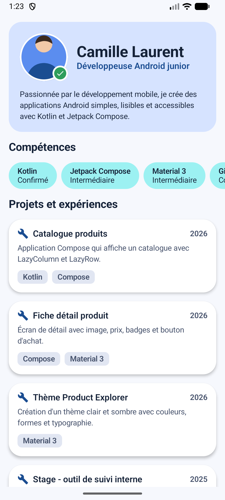
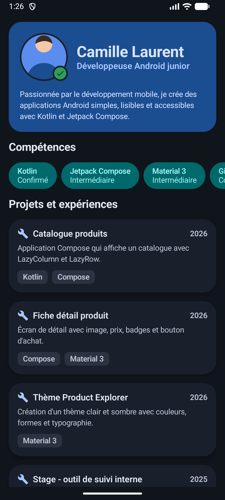
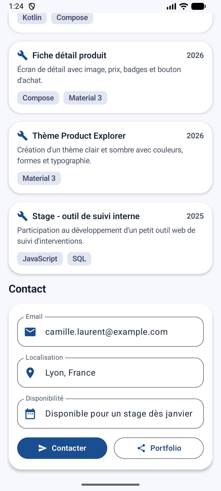

# Profil développeur Compose - version améliorée

## Description

Application Android réalisée avec Jetpack Compose pour le devoir.
Elle reprend la fiche « Profil développeur » des séances précédentes et la transforme en un vrai écran de profil :
un en-tête avec avatar et badge de disponibilité, une liste horizontale de compétences, une liste de projets,
et une zone contact avec deux boutons d'action.

Toutes les données sont locales (data classes Kotlin dans `data/SampleData.kt`).
Il n'y a ni API, ni base de données, ni ViewModel, ni navigation.

## Composants Compose utilisés

- `Text` : nom, rôle, description, titres de sections, textes des cartes.
- `Image` : photo de profil (avatar en vector drawable `avatar_placeholder.xml`) avec `painterResource`.
- `Icon` : badge de disponibilité (`Check` / `Close`), icône des projets, icônes des champs de contact et des boutons.
- `Button` : bouton principal « Contacter ».
- `OutlinedButton` : bouton secondaire « Portfolio ».
- `Card` : `ProjectCard` et `ContactCard`.
- `OutlinedTextField` en lecture seule (`readOnly = true`) : email, localisation et disponibilité.
- `Scaffold` : structure de base de l'écran.

## Layouts utilisés

- `Column` : empilement vertical dans l'en-tête, les cartes et la zone contact.
- `Row` : avatar + nom/rôle, titre + année d'un projet, tags de technologies, les deux boutons.
- `Spacer` : espaces entre l'avatar et le texte, entre les icônes et les textes des boutons, etc.
- `Box` : `ProfileAvatar`, l'image ronde avec le badge de disponibilité superposé en bas à droite (`Alignment.BottomEnd`).
- `Surface` : zone d'en-tête thémée (`primaryContainer`), les chips de compétences, le badge et les tags de technologies.
- `LazyColumn` / `LazyRow` : voir ci-dessous.

## Les listes LazyColumn et LazyRow

L'écran entier (`ProfileScreen`) est une seule `LazyColumn`. Elle mélange :

- des `item { }` pour les éléments uniques (en-tête, titres de sections, zone contact) ;
- `items(profile.projects, key = { it.id })` pour afficher chaque projet avec le composable réutilisable `ProjectCard`.

Les compétences sont affichées dans une `LazyRow` (`SkillsRow`) placée comme un `item` de la `LazyColumn`.
Chaque compétence est un `SkillChip` et la clé est aussi l'`id` de la compétence.

J'ai choisi une seule `LazyColumn` pour tout l'écran plutôt qu'une `Column` scrollable qui contiendrait une `LazyColumn`,
pour éviter d'imbriquer deux listes qui défilent dans le même sens.
Le `contentPadding` et `Arrangement.spacedBy(16.dp)` gèrent l'espacement entre les éléments.

## Choix du thème

Le thème est dans `ui/theme` (`Color.kt`, `Type.kt`, `Shape.kt`, `Theme.kt`) :

- **Couleurs** : un bleu pour `primary` (couleur « tech », sérieuse pour un profil pro) et un vert d'eau pour `secondary`
  (chips de compétences). J'ai défini un `LightColorScheme` et un `DarkColorScheme` avec `background`, `surface`,
  `surfaceVariant` et les couleurs `on...` correspondantes. Le thème suit le mode du téléphone avec `isSystemInDarkTheme()`.
- **Pas de `dynamicColor`** : je veux garder les mêmes couleurs sur tous les téléphones.
- **Typographie** : `headlineMedium` pour le nom, `titleLarge` pour les titres de sections, `titleMedium` pour le rôle et
  les titres de projets, `bodyMedium` pour les descriptions et `labelLarge` pour les chips et tags.
- **Formes** : coins arrondis 8 / 16 / 24 / 32 dp. `large` pour les cartes et l'en-tête, `extraLarge` pour les chips
  (effet « pilule »), `medium` pour les champs de texte et `small` pour les tags.

Les composants n'utilisent pas de couleur en dur : ils passent par `MaterialTheme.colorScheme`, `typography` et `shapes`,
ce qui permet d'avoir automatiquement le rendu clair et sombre.

## Previews

Dans `MainActivity.kt` :

- `ProfileScreenLightPreview` : profil en thème clair ;
- `ProfileScreenDarkPreview` : même profil en thème sombre ;
- `ProfileScreenFullStackPreview` : un autre profil non disponible (badge gris).

## Captures

| Thème clair | Thème sombre | Zone contact |
|---|---|---|
|  |  |  |

Captures faites sur l'émulateur Android (Medium Phone, API 37).

## Quelles notions du chapitre Compose UI avez-vous réutilisées dans cette application ?

- **Découpage en composables réutilisables** : `ProfileHeader`, `ProfileAvatar`, `AvailabilityBadge`, `SkillChip`,
  `ProjectCard`, `TechnologyTag`, `ContactCard`, `ReadOnlyInfoField`, `SectionTitle`. Ils reçoivent leurs données en paramètres.
- **Le paramètre `modifier: Modifier = Modifier`** sur chaque composable, appliqué à l'élément racine.
  Le parent décide du padding externe (`padding(horizontal = 16.dp)` dans la `LazyColumn`)
  et le composant gère son padding interne (`padding(16.dp)` dans les cartes).
- **Ordre des modifiers** : par exemple `size` puis `clip(CircleShape)` puis `border` sur l'avatar.
- **Les layouts de base** `Column`, `Row`, `Box`, `Spacer`, avec `Alignment` et `Arrangement`, et `weight(1f)` pour
  partager la largeur entre les deux boutons.
- **Les données descendent, les événements remontent** : `ProfileScreen` reçoit `onContactClick` et `onPortfolioClick`
  et les transmet à `ContactCard`. Les callbacks sont vides pour l'instant.
- **Les listes Lazy** avec `items(..., key = { it.id })` et des data classes `...Ui` (`DeveloperProfileUi`, `SkillUi`, `ProjectUi`).
- **Material 3** : `Card` avec `CardDefaults`, `Surface`, `MaterialTheme.colorScheme / typography / shapes`, thème clair et sombre.
- **Accessibilité** : `contentDescription` sur l'image et le badge, `contentDescription = null` sur les icônes décoratives,
  `semantics { heading() }` sur les titres de sections et `mergeDescendants` sur les chips de compétences.
- **Previews** avec plusieurs jeux de données et les deux thèmes.
